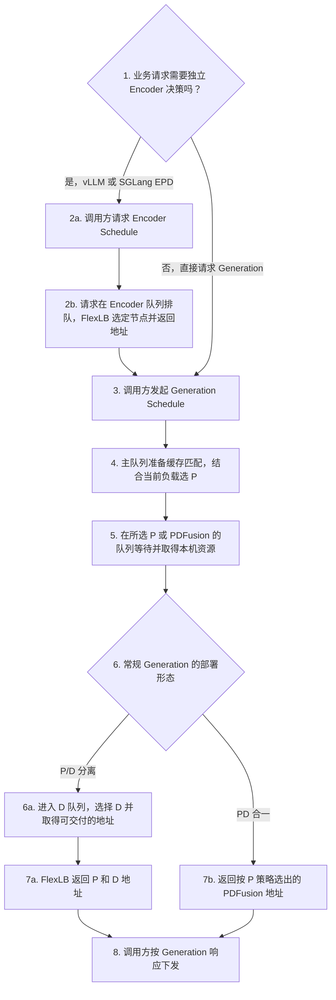
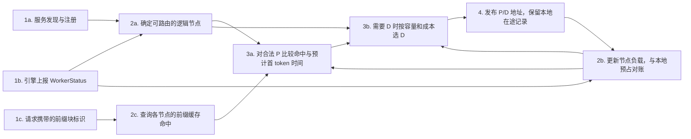

# FlexLB 架构总览

**FlexLB 决定请求发给哪台推理引擎，调用方按返回的地址下发，引擎负责执行。** 选路时，FlexLB 结合可用节点、缓存命中、队列负载和本地预占做决定；地址返回后，继续根据引擎上报更新负载和可用容量。

第一次读 FlexLB，先从本页看模块分工，再沿[一次 Schedule 的生命周期](01-request-lifecycle.md)走一遍请求。需要深入时，按问题选择：

- **`docs/architecture/`：** 服务如何协作、请求经过哪些阶段；`reference/` 提供配置、接口和指标的查询入口。
- **`docs/design/`：** 当前调度器为什么这样决策，例如[命中更多为什么仍没选中](../design/routing/02-generation-routing-decisions.md)、[地址已返回为什么还要占容量](../design/scheduling/02-capacity-and-release.md)。
- **`docs/implementation/`：** 对照具体类读源码，例如 [`WorkerStatus` 里哪些数据一起更新](../implementation/workers/03-worker-status-structure.md)。

构建、测试和提交约定见 [AGENTS.md](../../AGENTS.md)。

## 一个业务请求如何得到推理地址？

**要区分业务请求和 `Schedule` 调用。** 对 vLLM / SGLang 的 EPD（Encoder、Prefill、Decode 分离）部署，需要独立编码的业务请求分两阶段调度：调用方先请求 Encoder 地址，随后沿用同一业务请求 ID，**再次调用 `Schedule`** 请求 Generation 地址。不需要独立 Encoder 决策时，调用方直接请求 Generation。第二阶段里的选 P、选 D 是 FlexLB 处理**同一次** Generation 调用的两个步骤。

RTP-LLM 的 **ViT** 是另一种角色：ViT-only 调用走独立选路，不经过图中的 Encoder 阶段；同一部署不会同时出现 ViT 和 Encoder。看[角色路由](routing/01-role-routing.md)区分部署形态，看[一次 Schedule 的生命周期](01-request-lifecycle.md)追踪单次 RPC。

图中用 FlexLB 代表处理该次调度的副本。启用主选举时，收到请求的 follower 通常转发给 master；找不到 master 或满足特定转发失败条件时才在本地决策，并非任意 RPC 错误都本地重试。见[选主与转发](runtime/01-master-and-forwarding.md)。

## FlexLB 根据什么做决定？

下面是信息的流向。左侧的数据并行维护或按请求查询，不是每次 `Schedule` 都要从头执行的一串 RPC。

- **节点信息回答“谁能参加”。** 服务发现给出物理地址；FlexLB 按逻辑引擎维护注册和健康状态。每套部署只有一个流量 group。Worker 的 DP group 是另一件事：属于同一 DP 组的节点要等 rank 齐全才参与新请求的选择。见[发现与注册](workers/01-discovery-and-registration.md)。
- **缓存信息回答“在哪台 P 上能少算一些”。** FlexLB 用客户端提供的块标识，通过 `LOCAL_SYNC`、`KVCM` 或 `LOCAL_STANDBY` 获取命中情况。合法 P 先全部参与匹配，再结合负载判断为更多命中是否值得等待。缓存数据怎么来见[缓存匹配](../design/routing/03-cache-matching.md)；怎么影响排名见[Generation 选路决策](../design/routing/02-generation-routing-decisions.md)。
- **队列和预占回答“选好了，现在能不能发”。** 两次引擎上报之间，FlexLB 可能已为其他请求预留资源。若只看上次上报，可能把同一份容量分配两次。地址发布后归还排队名额，P/D 在途记录仍分别等待引擎确认、完成或超时清理。见[容量与释放](../design/scheduling/02-capacity-and-release.md)和[状态与反馈](workers/02-status-and-feedback.md)。

## 按问题找文档

阅读 `WorkerStatus.java` 时，可直接对照 [WorkerStatus 的对象结构与数据流](../implementation/workers/03-worker-status-structure.md)，定位内部类、快照发布和任务记录的来源。

| 问题 | 专题 |
|---|---|
| 节点没进候选集合？ | [角色路由](routing/01-role-routing.md) → [发现与注册](workers/01-discovery-and-registration.md)：先确认请求角色，再查 group、健康状态和 DP rank。 |
| 进了候选却没选中？ | [缓存匹配](../design/routing/03-cache-matching.md) → [Generation 选路决策](../design/routing/02-generation-routing-decisions.md)：区分缓存没命中和命中了但等待成本过高。 |
| 已选 P，为什么还没返回地址？ | [AutoTPM：队列、优先级与抢占](../design/scheduling/01-autotpm.md) → [容量与释放](../design/scheduling/02-capacity-and-release.md)：区分等 P 出队和已占 P 资源等 D。 |
| 地址已返回，为什么在途数还没降？ | [容量与释放](../design/scheduling/02-capacity-and-release.md) → [状态与反馈](workers/02-status-and-feedback.md)：区分调度完成、引擎接收和引擎完成。 |
| 哪个副本处理请求，上下线时会发生什么？ | [选主与转发](runtime/01-master-and-forwarding.md) · [启动与停机](runtime/02-startup-and-shutdown.md) |
| Master 或 KVCM 不可用时的请求处理 | [容灾与降级](../design/runtime/03-failover-and-degradation.md)：区分换主、单次本地调度和缓存来源切换。 |
| 怎么配置、调用和排查？ | [配置](reference/01-configuration.md) · [接口契约](reference/02-api-contracts.md) · [可观测性](reference/03-observability.md) |

## 技术栈

| 类别 | 技术 |
|---|---|
| 语言 | Java 21 |
| 框架 | Spring Boot 2.7.18（WebFlux 响应式，HTTP 端点返回 `Mono`/`Flux`） |
| 响应式 | Project Reactor 2024.0.10 |
| RPC | gRPC 1.65.0（worker 状态同步 + KVCM meta service） |
| 协调 | Apache Curator 5.4.0（ZooKeeper LeaderSelector 主选举） |
| 本地缓存 | Caffeine |
| 网络 | Netty 4.1.127.Final |
| 观测 | FlexMonitor 抽象（默认 NoOp，internal profile 下 KMonitor）、OpenTelemetry W3C 传播 |
| 测试 | JUnit 5 + Mockito 5.20.0 |

## 模块划分

[父 POM](../../pom.xml) 声明了 7 个模块。生产服务从 `flexlb-api` 启动，调度逻辑在 `flexlb-sync`；`flexlb-mock-engine` 和 `flexlb-integration-tests` 用于验证，不在生产请求链路上。

| 模块 | 职责 |
|---|---|
| **flexlb-api** | gRPC `Schedule` 入口与转发，HTTP 控制、健康检查和生命周期 hook；HTTP 主端口 7001 |
| **flexlb-common** | 共享模型（`WorkerStatus`、`Request`/`Response`、`RoleType`、`BalanceContext`）、`FlexlbConfig`/`ConfigService`、`FlexMonitor` 指标抽象 |
| **flexlb-grpc** | 引擎 gRPC 客户端（worker status / cache status）+ KVCM meta-service 客户端（`KvcmGrpcClient`、leader 解析、健康探测） |
| **flexlb-sync** | 核心：路由与策略、排队调度、动态资源管理、worker 状态同步、主选举、生命周期 Hook、监控上报 |
| **flexlb-cache** | KV cache 匹配：LOCAL_SYNC 两级索引（`KvCacheManager`/`GlobalCacheIndex`/`EngineLocalView`）、KVCM provider、Local Standby 兜底索引、failover 编排 |
| **flexlb-mock-engine** | 模拟引擎集群和负载客户端，用于验证调度、扩缩容和故障场景。使用方法见[模块 README](../../flexlb-mock-engine/README.md)。 |
| **flexlb-integration-tests** | 独立的 Maven Failsafe 测试模块；当前 `src/` 中没有用例。`./mvnw -pl flexlb-integration-tests -am verify` 成功不代表跑过独立的端到端场景。 |

对接调用方时，注意内部按逻辑引擎地址区分 worker，对外返回物理地址，多引擎端点另带 `engine_index`，详见[接口契约](reference/02-api-contracts.md)。
