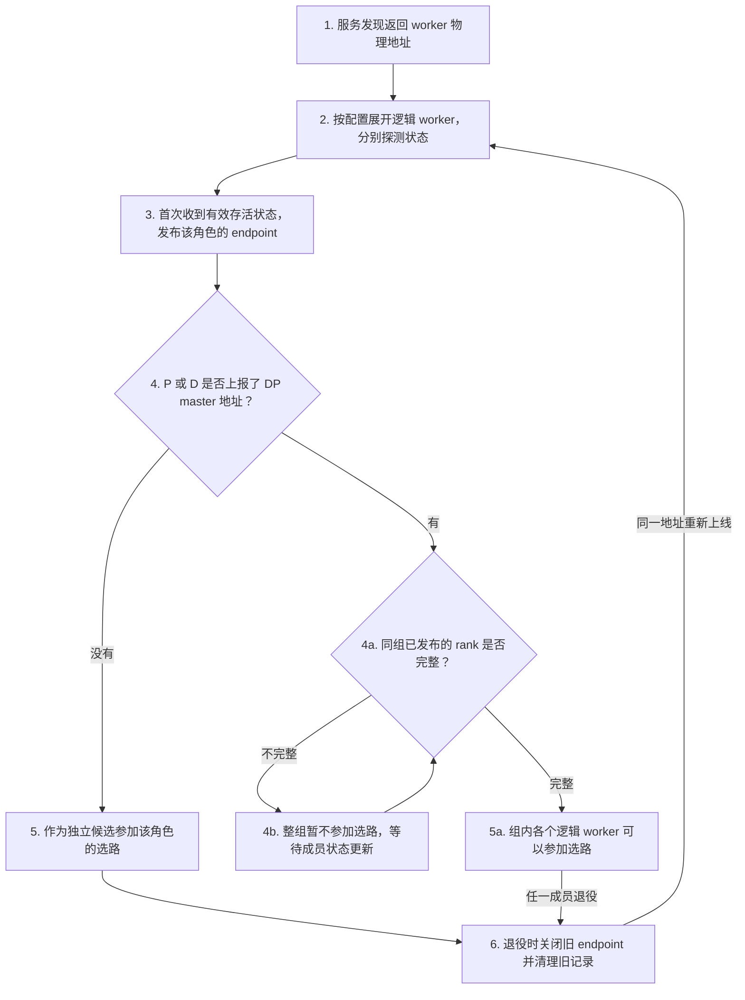

# Worker 发现与注册

**服务发现返回地址、FlexLB 注册节点、节点进入选路候选集，是三个不同的时刻。** 服务发现只说明去哪里探测；FlexLB 收到角色匹配、版本有效且 `alive=true` 的 WorkerStatus 后，才发布该逻辑 worker 的 endpoint。对上报了 DP 组的 P/D 节点，注册成功后还要检查同组 rank 是否齐全。

图中第 4–5 步针对 Generation 候选。流量 group 决定请求发往哪组服务，DP group 决定这些节点是否具备完整的并行拓扑；两者不是同一个配置。取得候选之后才做[缓存匹配与选点](../../design/routing/02-generation-routing-decisions.md)。

## EndpointRegistry

`EndpointRegistry` 按角色和逻辑地址 `ip:port@index` 维护 Prefill、Decode、P/D Fusion 与 VIT endpoint。
Encoder 有独立的 `EncoderEndpoint`，不会与同地址的 VIT 或 Generation endpoint 共用任务账本。
选中 Encoder 后，endpoint 记录尚未在 WorkerStatus 中出现的请求及预计未命中编码长度；
首次观察到任务前按 `seq_len - encoder_cache_hit_len` 记账。WorkerStatus 出现 waiting/running 任务后，
用该组去重后的未命中合成输入 `input_length` 替换预测值，直到任务结束；不扣减 `prefix_length`。
全命中组可能只上报 finished，其 `input_length` 是原始 prompt 长度，不计入编码负载；
finished、取消或失活后按请求 ID 清除本地记录。
同一地址的 `WorkerStatus` 代际变化时，registry 原子替换 endpoint 并关闭旧实例；
过期 worker 只能用当时观察到的 `WorkerStatus` 对象条件删除，避免删掉同地址的
新代际。

### 同地址重新注册的设计约定

同一 `ip:port` 要等旧 Worker 的下线清理流程结束后才能重新注册；新旧 Worker 不共用本地账本。
Worker 摘流后不参与新请求的选路；已选好 Worker 的 Decode 和 Encoder 请求在优雅下线窗口内仍按原地址下发。
Master 摘流后直接清理该 Worker 的本地记录，不等待选路线程。

## 服务发现与引擎地址

`WorkerAddressService` 按 Endpoint 保存最近一次成功的非空发现快照。查询异常、超过 500ms、
线程池拒绝任务或返回空列表时保留该快照，已有 worker 继续接受状态探测；首次发现尚无缓存时
返回空列表。发现线程池使用 AbortPolicy，饱和时不在同步线程执行网络查询。超时查询即使稍后
完成，也不会更新快照。成功的非空结果替换快照，允许正常的部分缩容与节点更换。

`EngineAddressResolver` 在构造阶段同步查询所有 Endpoint。查询抛出异常时阻止 Master 启动；
查询成功但返回空列表或 null 时，Master 可以启动并继续监听该 Endpoint，后续发现机器时发布地址。
定期查询和订阅回调同样忽略空列表，保留该 Endpoint 的地址，
避免关闭现有 channel 或清除已有 worker cache。无论空列表持续多久，都不把它作为撤销通知；
真实 worker 失效由健康探测处理。

FlexLB 将服务发现返回的每个 worker 物理地址按 Endpoint 配置的 `multi_engine_num` 展开为 N 个逻辑 worker，map key
统一为 `ip:httpPort@index`（N=1 也是 `@0`）。这些逻辑 worker 共用业务 HTTP/gRPC 地址；第 i 个
`GrpcWorkerStatusRunner` 连接显式配置的 `worker_status_port + i`，N=1 时同样接受该覆盖；
未配置时使用发现归一化后的 gRPC port。N>1 必须显式配置 status base，配置加载时同时校验 count、base 和
`base + N - 1 <= 65535`。

例如，发现 `10.0.0.8:8000`，配置 `multi_engine_num=2`、`worker_status_port=9000`：FlexLB 分别探测 `10.0.0.8:9000` 和 `10.0.0.8:9001`。若选中 `10.0.0.8:8000@1`，Schedule 返回物理业务地址并附 `engine_index=1`。这里的 `1` 是该地址上的逻辑引擎序号，不表示 `dp_rank=1`，也不表示 `tp_rank=1`。

`EngineAddressResolver` 向唯一的 pooled `EngineGrpcClient` 发布结构化 `WorkerHost`，保留业务
gRPC 端口和 worker status 端口。客户端按 `ip:实际RPC端口:serviceType` 复用 channel：
`GetWorkerStatus` / `GetCacheStatus` 使用 `worker_status_port + i`，`EnqueueBatch` / `Cancel`
使用 worker 共享的业务 gRPC 端口。多引擎的业务 channel 去重，状态 channel 按 engine 端口独立创建。
KVCM 开启时不创建 `GetCacheStatus` channel。该规则对所有 discovery provider 一致；worker IP
完全退出发现集合后关闭其 channel。endpoint 配置不热更新，端口变更依赖进程重启。

worker 地址表示由不可变 `WorkerIdentity` 一次性预计算并保存，调用方不再解析或临时拼接：

| 表示 | 格式 | 用途 |
|---|---|---|
| raw IP | `ip` | 网络连接与服务发现 |
| raw port | `port` | worker 的业务端口 |
| raw engine index | `engineIndex` | 逻辑引擎序号 |
| physical IP-port | `ip:port` | 服务发现返回的 worker 物理地址，用于匹配下线节点的缓存记录 |
| logical IP-port | `ip:port@index` | 路由、rollback、KVCM 与 cache key |
| metric IP-port | N=1 为 `ip:port`；N>1 为 `ip:port@index` | Encoder、step、阶段耗时与缓存预测对照的 `engineIp` 标签 |

`WorkerHost` 在服务发现展开时持有该 identity；N=1 的内部 logical identity 仍保留 `@0`。仅在
metrics 边界通过 `WorkerStatus.getMetricIpPort()`（或 `ServerStatus` 对应方法）选择兼容地址，
不会改变路由、cache 或 rollback 的 identity。

## DP 组可路由条件与退役

`dp_master_address` 保存 Engine 状态上报的 DP master 地址，随同一次状态事务写入
`WorkerStatus.committedEngineObservation()`；未上报时为 `null`。
Prefill 和 Decode 决策按非空 `dp_master_address` 识别 DP 组，与流量策略的 `group` 分别处理。
只有组内可路由 endpoint 覆盖 `dp_size` 指定的全部 rank（从 0 到 `dp_size - 1`，
各 rank 唯一且成员报告的 `dp_size` 一致），这一组的 worker 才能进入候选集。
任一 rank 的 endpoint 不可路由时，整组暂不参与新请求的选择；地址为 `null` 的
worker 作为独立节点按可用性规则选择。
任一 worker 进入退役流程时，`WorkerDirectory` 将同角色、同 `dp_master_address` 的其余
已知成员也置为 `RETIRING` 并关闭各自的 endpoint 调度入口，然后等待 endpoint 退役、
清理缓存索引并移除对应 WorkerStatus 代际。成员逐个获取状态锁，等待清理时不持有状态锁。
后续服务发现和有效状态上报可重新发布 worker；整组 rank 齐全后恢复参与路由。

例如，两个 P 上报相同 `dp_master_address` 和 `dp_size=2`。即使 rank 0 已注册且健康，只要 rank 1 尚未注册，rank 0 也不参加缓存匹配。若第二个节点错误地也上报 rank 0，虽然节点数已达到 2，仍不算完整。等 rank 0、1 各出现一次后，两者才进入候选集，最终只为这次请求选其中一个 P。

## TPU PP 全 Pod 发现

PP 部署的缓存匹配使用 `KVCM` 或 `LOCAL_STANDBY`。`LOCAL_SYNC` 仅支持 `PP=1` 的部署。

服务发现返回每组全部 PP Pod 时，可在对应 endpoint 启用 `pp0_routing_enabled`。
FlexLB 对每个发现的 Pod 轮询 `GetWorkerStatus`。首次提交状态或 `status_version` 增大时，
FlexLB 校验回包的 `pp0_ip` 是否等于被轮询的 Pod IP。只有校验通过且状态有效并为
`alive=true`，该 Pod 才能注册调度入口并参与缓存匹配。TPU 确定 PP0 后，各 Pod 在新版本状态中
返回同一个 PP0 裸 IP。同版本回包沿用已确认的 PP0 身份，仍按 `alive` 判断整条 pipeline 是否可用。

PP0 是整组的调度入口。PP0 上报 `alive=false`、状态探测达到失败阈值，或已注册入口的
新版本状态的 `pp0_ip` 校验失败时，FlexLB 关闭该 PP 组的入口。有 `dp_master_address` 时，同 role、同 DP
master 的成员也按原有流程退役。发现列表缺少 PP0 时，FlexLB 等距上次成功轮询超过状态过期阈值
后，再执行相同的退役流程。发现结果为空或查询异常时，继续探测最近一次非空快照中的 Pod。

## 跨机 TP：只有 TP rank 0 是调度入口

TP（tensor parallelism，张量并行）把同一次模型计算分给多个 rank。跨机 TP 部署中，**服务发现只返回每个 TP 组的 TP rank 0 worker 地址**。这是部署暴露的业务入口，不是 FlexLB 先发现全部 rank，再根据 `tp_size` 挑出 rank 0。

KVCM 返回的缓存命中可以覆盖所有 TP rank。例如，服务发现只返回机器 A（TP rank 0），KVCM 却同时返回 A 和 B（TP rank 1）。FlexLB 只在本地已发现且可路由的 worker 中选点：读取 A 对应的命中，B 即使命中更多也不能成为 Schedule 返回地址。如果 KVCM 只返回 B，A 仍是候选，但没有 A 自己的本地命中记录；不会把 B 当成新的业务入口。地址匹配规则见[缓存匹配](../../design/routing/03-cache-matching.md)。

| 部署示例 | FlexLB 实际选择什么 |
|---|---|
| 一个 TP 实例跨两台机器，对外只有一个业务入口；该地址配置 `multi_engine_num=1` | 一个逻辑 worker `@0`。不能因为有两台机器就配置成两个逻辑引擎；`multi_engine_num=2` 表示该地址确实暴露两个可分别探测、可按 index 寻址的引擎。 |
| `dp_size=2`，每个 DP rank 内部又通过跨机 TP 执行，两个 DP rank 上报同一 DP master | 服务发现暴露 `(DP rank 0, TP rank 0)` 和 `(DP rank 1, TP rank 0)` 两个入口。两者齐全后都可以参加选路；「只返回 TP rank 0」并不排除 DP rank 1。 |

因此，跨机 TP 中有成员异常时，FlexLB 能依据的是**对外入口的健康状态**；不能仅凭 `tp_size` 判断内部哪台机器失效，也不会根据机器 IP 自动把多个发现地址合并成一个 TP 实例。核对部署时，应区分服务发现实际暴露的入口、入口上报的 DP 字段和引擎内部的 TP 拓扑。

**实现入口：** [EngineStatusConverter](../../../flexlb-sync/src/main/java/org/flexlb/service/grpc/EngineStatusConverter.java) 读取并行拓扑字段；[WorkerDirectory](../../../flexlb-sync/src/main/java/org/flexlb/sync/status/WorkerDirectory.java) 构造候选集并处理同组退役；[DpGroupMembers](../../../flexlb-sync/src/main/java/org/flexlb/sync/status/DpGroupMembers.java) 校验 rank 的范围、唯一性和完整性。WorkerStatus 缺少某个**请求**的确认不等于 worker 失联，对应的处理见[容量与释放](../../design/scheduling/02-capacity-and-release.md)。
