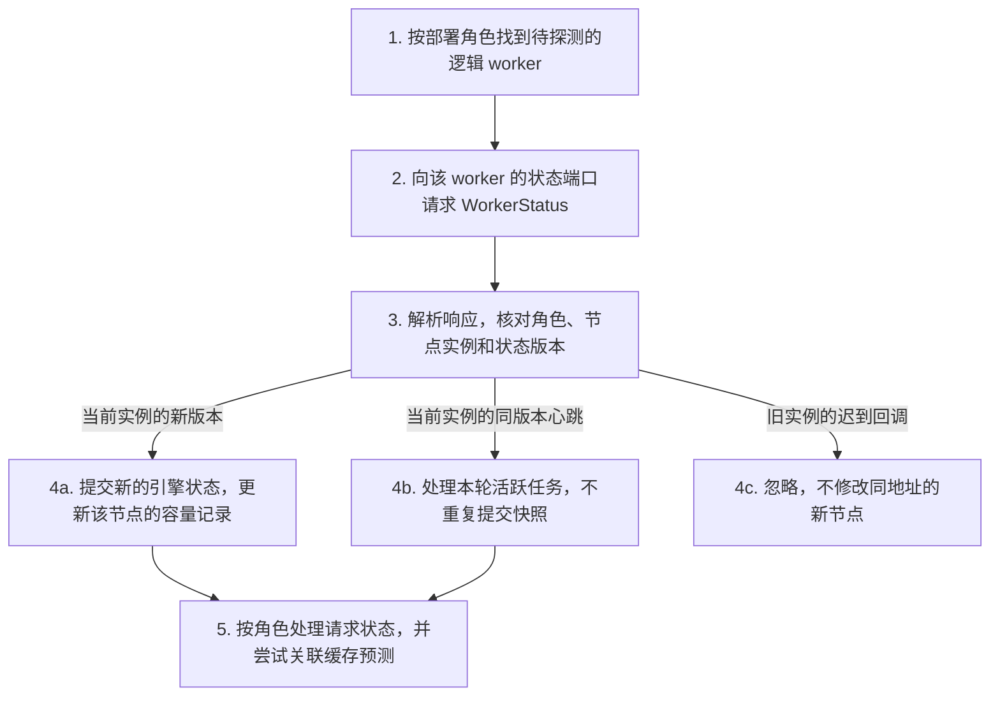

# Worker 状态与反馈

FlexLB 主动轮询每个逻辑 worker。一次 `WorkerStatus` 响应提供三类信息：**节点是否还能接请求、引擎正在处理哪些请求、哪些请求已经结束**。前两类用于更新选路和容量，完成记录还可用于核对先前的缓存命中预测。响应里没有某个请求 ID，与整个 worker 不可用，是不同的情况。

## 一次状态轮询

Java 对象之间的引用见 [WorkerStatus 类图](../../implementation/workers/03-worker-status-structure.md#一个-workerstatus-实例的布局)；核对引擎上报值时，查[附录：WorkerStatus 协议字段](../../implementation/workers/03-worker-status-structure.md#附录workerstatus-协议字段)。

`MasterEngineSynchronizer` 按 `workerRegistry.health.statusPollIntervalMs` 启动轮询，单次状态 RPC 的超时由 `statusRpcTimeoutMs` 控制。每个逻辑 worker 同时最多有一次在途状态探测；有多个逻辑引擎时，分别请求对应的状态端口，见[发现与注册](01-discovery-and-registration.md)。**这是后台工作，不是每次 Schedule 都去查询所有 worker。** WorkerStatus 轮询也不同于 `GetCacheStatus`：前者持续跟踪任务和负载；后者为 [LOCAL_SYNC 缓存索引](../../design/routing/03-cache-matching.md)提供块信息，使用 KVCM 时不再调度这项本地缓存轮询。

### 状态版本和完成记录游标

`status_version` 决定是否提交新的节点快照；`latest_finished_version` 用在下一次 RPC 中，告诉引擎 FlexLB 已经读到了哪一批完成记录。前者描述整台节点，后者用于增量拉取 Finished，不是请求 ID。FlexLB 将引擎字段和两个已提交的版本一起保存在 `CommittedWorkerStatus`，读取同一快照时不会把本轮任务表与上一轮游标混用。

| 收到的结果 | 当前处理 |
|---|---|
| 当前实例、角色匹配、版本递增且存活 | 提交新快照。首次有效状态可以发布 endpoint；已发布的 endpoint 用这次状态更新本地记录。 |
| 当前实例、存活、版本与已提交版本相同 | 当作心跳，不重放新版本的状态变更。活跃任务仍有意义：例如 D 会刷新本轮出现的请求的最近上报时间，但不在同版本心跳中扫描缺失请求的超时。 |
| 当前实例上报非正版本、版本倒退、角色不匹配，或明确上报 `alive=false` | 启动该实例的退役流程，不用异常响应覆盖正常的路由视图。有 DP 组时，同组成员的处理见[DP 组退役](01-discovery-and-registration.md#dp-组可路由条件与退役)。 |
| 回调属于已经替换或正在退役的旧实例 | 忽略。即使地址相同，也不能用旧 worker 的响应修改新 worker 的状态。 |
| RPC 或响应转换连续失败 | 同一实例连续失败 3 次后启动退役；一次探测失败不等于 worker 已下线。 |

## 请求状态对选路和容量的影响

`running_task_info` 是引擎的**活跃任务列表**，并非每个任务都在计算。FlexLB 按业务请求 ID 查找任务，再看 `phase`：`RECEIVED` 表示已收到，`KV_ALLOCATED` 表示已分配 KV，`RUNNING` 才表示正在执行。`running_query_len` 和 `waiting_query_len` 是引擎直接上报的计数，不能用活跃列表的长度代替其中任一个。`finished_task_list` 则是独立的完成记录，可以先于 FlexLB 观察到任何中间阶段到达。

| 上报来自 | 如何使用 |
|---|---|
| Prefill / PDFusion | `PrefillQueue` 按 ID 对照本地在途记录与引擎活跃列表，避免重复计算同一请求。实际命中和剩余计算量可用于修正该节点预计还有多少工作；`remaining_prefill_tokens` 未上报与明确上报 0 含义不同。Finished 可直接清除对应 P 记录。 |
| Decode | `DecodeState` 区分「收到请求」与「已分配 KV 或开始运行」。早期活跃上报可以刷新最近出现时间；`KV_ALLOCATED` 或 `RUNNING` 才把本地预占转为引擎已确认的负载。Finished 结束对应 D 的记录，不能由 P 的 Finished 代替。 |
| Encoder | 活跃上报用于核对本地尚未观察到的编码请求，完成记录中的错误码决定这个 **Encoder 阶段**成功还是失败。它不是同一业务 ID 后续 Generation 阶段的完成通知。 |

**例如，P 已报 Finished，D 本轮没报这个 ID。** 可以据此清理 P 的记录，但不能断定 D 没收到请求，更不能据此摘除 D 节点。D 需要按自己的记录、完成上报与确认超时处理。发布前后各占哪些名额、P/D 对活跃 ID 消失的不同处理，以及 `statusUpdateTimeoutMs` 的取舍，统一见[容量与释放](../../design/scheduling/02-capacity-and-release.md)。

## 缓存预测与引擎实际命中的对照

1. **选中 P 时记下预测。** FlexLB 保存选中 worker、缓存来源、输入长度和预计命中 token 数，以「worker 实例代际、角色、请求 ID」关联后续上报。同一地址重新注册的新节点不能消费旧节点的预测。
2. **从对应任务读取实际值。** `RUNNING` 或 Finished 上报中，只有 `prefixLengthValid` 为真，且 `prefixLength` 落在 0 到输入长度之间，才能作为实际命中 token 数。有效的 0 表示没有命中；字段无效表示不知道。若同次响应的活跃和完成列表都有这个请求，优先处理完成记录。
3. **每份预测最多对照一次。** 如果运行中已经得到有效值，无需等 Finished 再算一次；如果直到 Finished 都没有有效值，可以记录预测，但不能据此报告实际命中为 0。Finished 后移除关联。异步对照或监控失败不会撤销已提交的节点状态，也不改变原调度结果。

例如请求输入 1,024 个 token，选中 P 时预计命中 768，引擎最终有效上报 640，则 `实际 − 预测 = −128`，表示高估了 128 个 token。这个差值用于验证缓存预测，并不表示要把已经返回的地址重新选一次。

请求的 received→waiting、waiting→running 及执行耗时取**引擎上报的时间戳**，不取 FlexLB 第一次轮询到各阶段的时间。时间戳 0 表示缺失；两个有效时间戳相等则是合法的零耗时。指标与 PV 字段见[可观测性](../reference/03-observability.md)。

**实现入口：** [轮询、版本判断与退役](../../../flexlb-sync/src/main/java/org/flexlb/sync/runner/GrpcWorkerStatusRunner.java) · [P 与 Encoder 的状态通知](../../../flexlb-sync/src/main/java/org/flexlb/balance/scheduler/EndpointEventHandler.java) · [缓存预测关联与去重](../../../flexlb-cache/src/main/java/org/flexlb/cache/match/CacheHitFeedbackTracker.java) · [缓存反馈端到端用例](../../../flexlb-sync/src/test/java/org/flexlb/sync/runner/CacheHitFeedbackFlowTest.java)。
