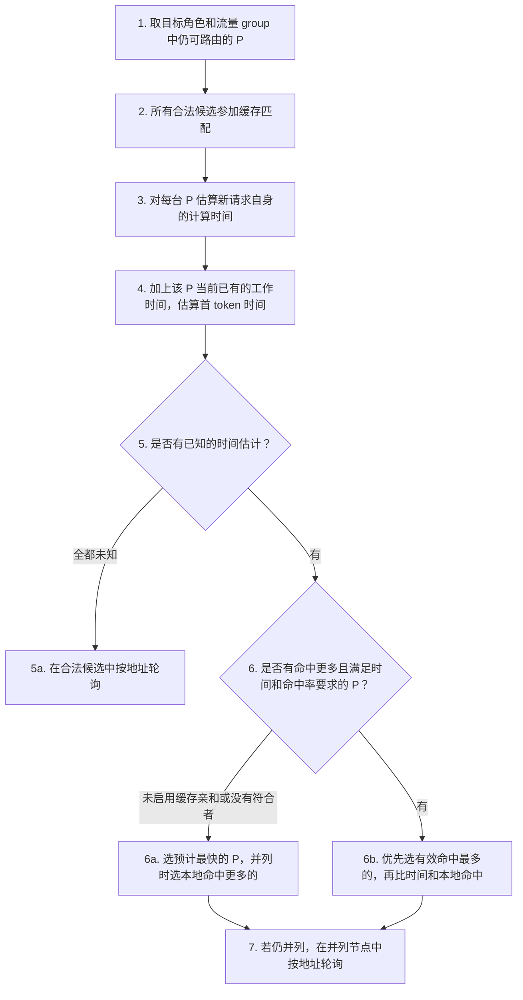
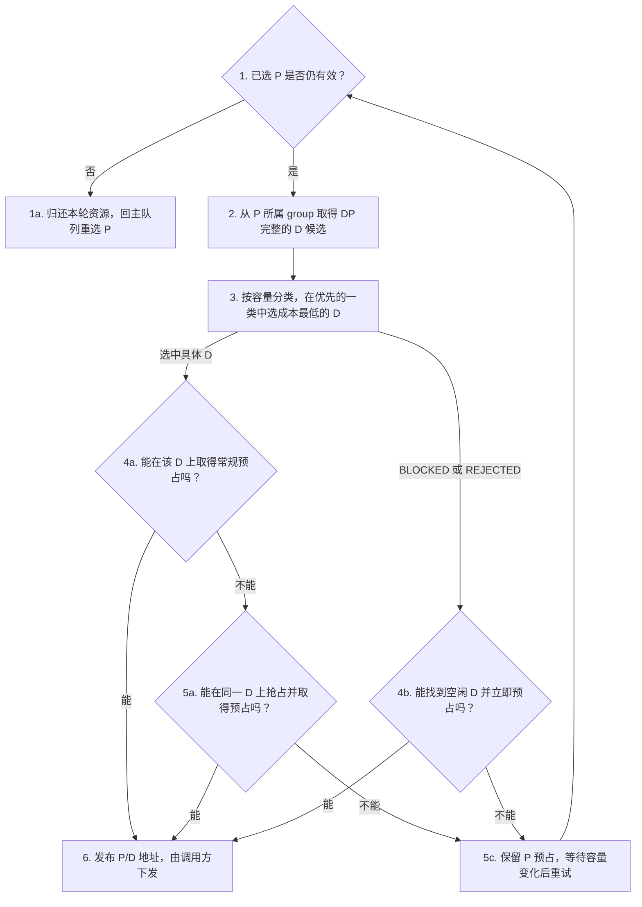

# Generation 选路决策

一次 Generation 调度先选 Prefill（P）：**在哪台节点上做这次输入计算，预计能更早得到第一个 token？** 如果还需要 Decode（D），再选：**哪台节点能接下后续生成，成本又最低？** 两次选择都只决定接下来向哪台节点申请资源。选中了节点，不代表已经取得名额，更不代表引擎已经开始执行。

## Prefill：缓存命中最多的 P，为什么不一定被选中？

假设 P1 已缓存一段常用前缀，P2 很空，却没有这段前缀。每当 P1 开始排队就把请求转给 P2，P2 就要为缺失的前缀重新建立 KV；缓存空间紧张时，新写入的 KV 还可能挤掉 P2 上其他请求常用的前缀。允许在 P1 排队，是为了让后续请求继续复用已有缓存，减少各节点反复淘汰、重建缓存的开销。选路时用预计首 token 时间衡量这个代价：可以为了命中多等一会儿，不是始终选命中最多的节点。

缓存命中能减少**新请求自己的计算时间**，但不能消除**这台 P 已经积累的工作**。FlexLB 分两次读取数据：准备阶段查询缓存，估算新请求在每台 P 上要算多久；最终选点时，再读取各台 P 最新的等待和在途工作量。这样，准备缓存结果期间新增加的负载也能影响选择。

**步骤 1–3：先确定谁有资格参加，再比较缓存。** P/D 分离部署使用 `PREFILL`，合一部署使用 `PDFUSION`。已摘流节点不参加；带 DP master 地址的一组节点必须有完整的可路由 rank，没有该地址的节点独立参加。这里不按在途数、剩余 KV 或预计等待时间提前删掉节点：即使某台 P 目前很忙，也要先得到它的缓存匹配结果。P 队列在出队时只检查本机在途上限。

同一份[缓存匹配结果](03-cache-matching.md)用于回答两个不同的问题：

| 问题 | 用哪个数 |
|---|---|
| 为了复用缓存，值得偏向哪台 P？ | 比较**有效命中 token 数**：本地命中，加上按 `remoteDiscount` 折算的远端增量。KVCM 用本次查询的最大 `global` 减去各节点自己的 `local`，取非负部分；其他来源只计本地命中。满命中时不扣一块。 |
| 新请求在这台 P 上还要算多久？ | 耗时模型用独立的 `localWeight`、`remoteWeight` 估算能省掉的计算量，至少保留一个块的输入计算量（不足一块时保留全部输入）。KVCM 来源按本次查询的最大 `global` 命中减去该节点的本地命中估算远端部分；其他来源只计本地命中。**不能直接拿有效命中数当作免算的 token 数。** |

**步骤 4–7：先找最快节点，再判断是否值得多等。** 这里的 TTFT（time to first token，首 token 时间）是用于比较 P 的估计值：`该 P 已有的预计工作时间 + 新请求自身的预计计算时间`，不是实测端到端延迟。如果该 P 有无法估算的引擎工作，它的 TTFT 是未知，而不是零。只要有估计值，就优先在时间已知的候选中选择；全都未知才走 5a。

启用缓存亲和时，步骤 6b 要同时满足三个条件：有效命中比**所有并列最快节点中最高的命中数**还多；有效命中率达到 `minPrefixHitPercent`；预计 TTFT 不超过 `最快 TTFT + maxExtraTtftMs`。满足条件的候选先比有效命中，再比 TTFT，最后比本地命中。

**按地址轮询（round robin，RR）**：每个角色和流量 group 分别记住上次选中的逻辑地址。本次从符合条件的节点中，按地址字符串顺序选上次地址之后的第一个；首次选择或到达末尾时，选地址最小的节点。步骤 5a 在全部合法候选中轮询，步骤 7 只在最终并列的节点中轮询。

### 算例：多等 8 毫秒，能不能换更多缓存命中？

假设输入为 1,000 个 token，最低有效命中率为 60%，允许为缓存多等 10 ms。以下是同一次决策中两台 P 的估计值，非配置默认值：

| 候选 | 有效命中 | 已有工作 | 新请求自身计算 | 预计 TTFT |
|---|---:|---:|---:|---:|
| P1 | 400（40%） | 10 ms | 30 ms | **40 ms** |
| P2 | 800（80%） | 36 ms | 12 ms | **48 ms** |

P1 最快，但 P2 命中更多、达到 60%，且 48 ms 没有超过 `40 + 10 = 50 ms`，所以选 **P2**（`CACHE_LEADER`）。如果 P2 的已有工作从 36 ms 增到 39 ms，其 TTFT 就变为 51 ms。即使缓存结果完全没变，此时也选 **P1**（`OVER_CAP`）。恰好 50 ms 仍满足上限。

### Prefill 缓存亲和决策原因（`cacheAffinityDecision`）

在 Schedule PV 的 `routingDecisions` 中，`reason=COST_BASED` 说明用了哪种选路策略；`cacheAffinityDecision` 才解释**这次是否为了更多缓存命中，选择一台预计更慢的 P**。判断用的是本次请求的预测**有效命中**，不是引擎执行后的实际命中。“命中更多”是与**所有并列最快节点中的最高有效命中**相比。只有 `CACHE_LEADER` 改按缓存亲和规则选点，其余七种都沿用基础策略：先比预计 TTFT，再比本地命中，仍并列才轮询。

| `cacheAffinityDecision` | 本次决策的含义 |
|---|---|
| `CACHE_LEADER` | 有节点比最快组命中更多，达到最低有效命中率，且预计 TTFT 不超过允许上限（恰好等于也算）。在这些节点中先选有效命中最多的。 |
| `FASTEST_IS_CACHE_BEST` | 最快组中已经有节点达到全部候选的最高有效命中，且命中大于零。没有必要为更多命中而多等；不代表每个并列最快节点的有效命中都一样。 |
| `LOW_CACHE_HIT` | 有节点比最快组命中更多，但这些节点都没达到 `minPrefixHitPercent`。例如前面算例中，命中从 40% 提升到 55%，仍不够 60% 的门槛。 |
| `OVER_CAP` | 有命中更多且命中率达标的节点，但没有一个能确认在 `最快 TTFT + maxExtraTtftMs` 以内。可能是预计太慢，也可能是这些达标节点的 TTFT 全都未知。只有前者能给出具体的 `overCapMs`；这里的 cap 是时间上限，不是 KV 容量。 |
| `NO_CACHE_ANYWHERE_BELOW_BLOCK_SIZE` | 所有候选有效命中均为零，且输入长度**小于**本次查询的块大小。优先记录这个原因，不论来源是不是 KVCM；恰好一整块不属于此类。 |
| `NO_CACHE_ANYWHERE_KVCM` | 所有候选有效命中均为零，输入不属于不足一块的情况；KVCM 查询成功，整个返回结果也没有任何正的 `global` 命中（包括成功返回空列表）。这不是查询失败。 |
| `NO_CACHE_ANYWHERE_BUT_KVCM_HAS_HIT` | 所有候选有效命中均为零，输入不属于不足一块的情况；但 KVCM 成功响应里至少有一台主机 `global > 0`。例如唯一有缓存的主机不在可路由候选里。这里比较的是**所有合法候选的有效命中**与**整份响应的原始 global 命中**。 |
| `NO_CACHE_ANYWHERE` | 所有候选有效命中均为零，且不满足上面三种更具体的条件。例如输入足一块、实际查的是本机 standby，候选全未命中。不能据此断言整个 KVCM 没有缓存。 |

**字段缺失不等于零命中。** 没有缓存亲和配置，或所有候选的 TTFT 都未知时，不评估缓存亲和，也就没有这个原因值；后者按地址轮询。枚举和判定分支分别见 [`CacheAffinityDecision`](../../../flexlb-sync/src/main/java/org/flexlb/balance/strategy/CacheAffinityDecision.java) 和 [`CostBasedPrefillStrategy`](../../../flexlb-sync/src/main/java/org/flexlb/balance/strategy/CostBasedPrefillStrategy.java)。

## 选好 P 后，什么时候还需要选 D？

P 必须先取得本机在途名额。只有部署了 `DECODE`，且本次请求也需要 `DECODE`，才进入共享 D 队列；未指定角色时按部署角色处理。PDFusion 或只请求 P 时，检查已选 P 仍有效后，直接返回这个地址。**分离部署中即使只请求 Decode，当前 V2 仍先选 P，成功时返回 P/D 两个地址。** 角色入口见[角色路由](../../architecture/routing/01-role-routing.md)。

## Decode：为什么选中了 D，还要等资源？

**选择读取的是节点快照，预占才是在这台 D 上实际申请资源。** 因此，选到繁忙节点后申请失败，与根本没选出节点，是两条不同的分支。下图是同一请求的一轮 D 调度；等待重试时仍保留 P 预占。

**步骤 2–3：先比较容量，再比较成本。** D 使用请求进入 FlexLB 时的配置快照。已知节点的总 KV 时，单机预算为 `总 KV × maxKvUsagePercent / 100`，向下取整。调度器分别看并发名额、输入需要的 KV（`seqLen`），以及包含最大输出的预算（`seqLen + maxNewTokens`）；最后一个数是预算，不是预测本次会生成多少 token。

| 容量分类 | 对本请求意味着什么 | 怎么选 |
|---|---|---|
| `READY` | 按当前快照，并发、输入 KV 和总预算都够 | 只要有 `READY`，就在这些节点中比较成本。 |
| `BUSY` | 不是请求本身超过单机预算，而是按当前占用暂时放不下 | 没有 `READY` 时，V2 可以从 `BUSY` 中选一台，再到该节点实际申请资源。选中不等于保证成功。 |
| `IMPOSSIBLE` | 即使不考虑已有请求，本请求的输入加最大输出也超过该节点已知的单机预算 | 不参与普通成本比较。所有候选都属于此类时，选择器返回 `REJECTED`，交给步骤 4b。 |

在选定的一类节点中，按配置的成本公式比较负载、并发上限、真实 KV 用量和总 KV，成本越低越优先，同分按地址轮流选择。没有合法 D 候选时返回 `BLOCKED`。空机分支仍要求 group 匹配、DP rank 完整，不会绕过这些条件。

**步骤 4a 与 4b 的区别，可以用同一台 D 看清楚。** 假设只有 D1，节点总 KV 为 10,000，预算比例为 90%，即单机预算 9,000：

- 请求需要的总预算为 **8,000**，但 D1 已有任务使剩余预算不足：D1 是 `BUSY`，仍可能被选中。常规预占失败后，只能在 **D1** 上尝试配置允许的抢占；不能抢占就等待。这次失败**不会直接跳到 4b**。
- 请求需要的总预算为 **9,500**：D1 属于 `IMPOSSIBLE`。常规选择返回 `REJECTED`，但这不是最终给客户端的拒绝。若 D1 上报的运行数和等待数都是零，而且本地既无预占也无引擎已确认的请求，FlexLB 可在节点锁内确认空闲并为这一个请求预占，再返回地址。D1 不空就等待。

图中画的是节点正常在线时的路径。有两个发布边界：已选 D 在常规预占时摘流，仍可能按原地址返回，依赖 worker 的优雅下线窗口；取消若先于发布成功，则归还未发布的预占。每轮开始时检查 P，不代表发布瞬间再次联合检查 P 和 D。抢占返回哪些请求 ID、由谁处理，见 [AutoTPM](../scheduling/01-autotpm.md)。

## 对照一次实际选路记录

- **P 没出现在日志里：** 先核对角色、group、注册状态和 DP rank，再查 Prefill 的 `routingDecisions` 是否已截断。记录最多列 5 个候选，优先包含选中节点；没列出不等于没参加。对列出的候选，结合 `effectiveHitTokens`、`estimatedTtftMs` 和 `cacheAffinityDecision` 判断是命中不足还是多等的时间超限。
- **D 已被选中但没有立即返回：** `DECODE_MIN_COST` 或 `DECODE_MIN_COST_ROUND_ROBIN_TIEBREAK` 说明选择器选到了节点，不证明预占或发布成功。结合 `DECODE_WAITING` 阶段的容量阻塞原因和最终 Schedule 响应判断，指标口径见[可观测性](../../architecture/reference/03-observability.md)。

实现入口：[Prefill 的准备与比较](../../../flexlb-sync/src/main/java/org/flexlb/balance/strategy/CostBasedPrefillStrategy.java)、[Decode 的分类与评分](../../../flexlb-sync/src/main/java/org/flexlb/balance/strategy/DecodeSelector.java)、[Decode 的预占与发布](../../../flexlb-sync/src/main/java/org/flexlb/balance/schedulev2/decode/DecodeQueueConsumer.java)。
