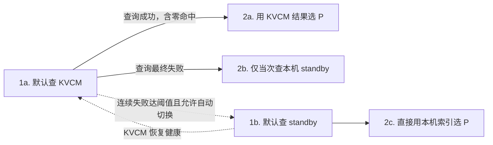

# 容灾与降级：FlexLB 换主、转发失败与 KVCM 不可用

假设 FlexLB 有两个副本：M 是 master，F 是 follower。一条 Generation 请求到达 F，正常情况下 F 转发给 M，由 M 查 KVCM、选 P/D、返回地址。这里有两个独立的决定：**哪个 FlexLB 副本调度请求**，以及**这个副本用什么数据估计缓存命中**。M 下线不要求切走 KVCM；KVCM 宕机也不要求 FlexLB 换主。

## FlexLB 主从切换与转发失败后的本地调度

启用 ZooKeeper 选主时，M 正常下线会主动让主；与 ZooKeeper 的连接进入 `SUSPENDED` 或 `LOST` 时，也会放弃领导权。其他参与者可以当选。新 master 通知其他副本刷新地址，副本也定期从 ZooKeeper 刷新。换主改变的是**后续请求的转发目的地**：当前没有把旧 master 内存中的排队请求、本地资源预占或 standby 索引移交给新 master 的机制。未启用选主（`consistency.type=NONE`）时，各副本直接本地调度。

**换主期间到达 F 的请求，不一定要等新 master。** 对仍有效的 `Schedule`，F 按这次转发的结果决定是否本地处理：

| F 看到的结果 | 这条请求如何结束 |
|---|---|
| 找不到 master 地址 | F 沿用原请求 ID 和截止时间，本地调度。F 不因此成为 master。 |
| 对端明确返回 `NOT_MASTER`，且未接管请求 | F 本地调度。判定要求失败响应未标记入队，也不带生命周期、节点结果或准入拒绝原因。 |
| gRPC 返回 `UNAVAILABLE` 或 `UNKNOWN`，异常链中有 `IOException` 或 `UnresolvedAddressException` | F 可本地调度。连接断开时，M 可能已经收到请求，只是响应没回来；这里保可用性，不保证跨副本只调度一次。 |
| M 已给出业务拒绝，或只是 RPC 超时、取消、没有上述网络异常证据 | F 不再调度一次。原请求已取消或过期时，即使原本符合本地降级条件也不会重新入队。 |

因此，单条 PV 中的 `LOCAL_FALLBACK` 说明 F 处理了这条请求，不证明发生过选举。选举通知和正常停机顺序分别见[选主与请求转发](../../architecture/runtime/01-master-and-forwarding.md)、[启动与停机](../../architecture/runtime/02-startup-and-shutdown.md)。判定代码见 [`shouldScheduleLocally`](../../../flexlb-api/src/main/java/org/flexlb/httpserver/FlexlbServiceImpl.java)。

## KVCM 查询失败时的单次兜底与持续故障时的自动切换

`LOCAL_STANDBY` 是**每个 FlexLB 副本用自己成功路由过的请求建立的内存索引**，不是 KVCM 的数据副本。即使正常使用 KVCM，本机也会异步记录选中的 P 和请求前缀，以便故障时立即查询。它能估计本地前缀，不能提供 KVCM 的远端增量。`LOCAL_SYNC` 则需要从 worker 同步块清单，是另一种启动模式，不在这条故障切换路径上。三种数据来源见[缓存匹配](../routing/03-cache-matching.md)。

配置为 `cacheMatching.type=KVCM` 时，看两条路径。**实线是当前请求怎么取结果；虚线是健康状态怎么改变下次查询的起点。**

- **当次查询。** 缺少必要的 worker 元数据、找不到 KVCM leader 或 RPC 最终失败，都走 2b。RPC 默认最多重试一次，共用 500 ms 的预算。关闭 `cacheMatching.localStandby.autoSwitch` 不影响当次兜底。
- **切换阈值。** 预热后，同一副本连续查询失败 `queryFailureThreshold` 次（默认 15,000，可通过 Nacos 热更新），或连续心跳失败 `heartbeatFailureThreshold` 次（默认 3），就判为不健康。一次请求的内部重试不单独计数。只有开启 `autoSwitch`（默认开启）才切换默认来源。
- **恢复阈值。** 心跳或查询中的任一种连续成功 `recoverySuccessThreshold` 次（默认 3）即可恢复，两种计数不相加。切走后没有 KVCM 查询流量，仍有心跳探测。显式配置 `type=LOCAL_STANDBY` 则固定查本机，只有改回 `KVCM` 才重新选源。

源码：[单次查询与兜底](../../../flexlb-cache/src/main/java/org/flexlb/cache/match/CacheMatchQueryOrchestrator.java)、[失败与恢复计数](../../../flexlb-grpc/src/main/java/org/flexlb/engine/grpc/client/KvcmGrpcClient.java)、[配置与健康状态如何决定默认来源](../../../flexlb-cache/src/main/java/org/flexlb/cache/match/CacheMatchFailoverManager.java)。

## 同时换主和切换缓存来源时的排查顺序

如果 M 已下线，F 接手调度时 KVCM 又不可用，要分别看两份数据：

- **节点负载：** F 在转发期间也独立轮询 `WorkerStatus`，能按自己最近观察到的节点和负载选 P。它缺的是 M 已分配、尚未被引擎上报确认的本地在途记录，因此可能低估占用。见[主从副本的轮询与记账](../../architecture/runtime/01-master-and-forwarding.md#master-转发与本地降级)。
- **缓存预测：** F 查的是自己的 standby。它不会为仅转发的请求积累索引；即便 M 的索引很热，F 仍可能预测为零。这说明 F 缺少路由历史，不意味着引擎丢了 KV。

先从该请求的 PV 确认实际调度副本，再在**那个副本**查询 `GET /flexlb/cache_match/status`：

- `configuredMode=KVCM`、`effectiveSource=KVCM`：默认仍查 KVCM。指标 `app.cache.match.standby.fallback.qps` 中的 `kvcm_query_failure` 表示当次查询失败后用了备用结果；状态接口是当前值，不是该请求的历史记录。
- `configuredMode=KVCM`、`effectiveSource=LOCAL_STANDBY`：结合 `kvcmHealthState`、`lastSwitchReason` 和 `lastSwitchTimeMs` 检查自动切换。`active_source` 表示请求开始时就直接走 standby。
- `configuredMode=LOCAL_STANDBY`：这是配置指定的来源。`localStandbyEntries` 是本副本的块与节点映射数，可用来区分空索引和已有历史但本次前缀未命中。

另有一个范围更大的显式开关：`enableFallback=true` 时，`Schedule` 入口直接返回业务码 `8600`，由**调用方**选路。FlexLB 既不转发给 master，也不查缓存或入队。它不是 KVCM 不健康或 ZooKeeper 换主自动触发的开关。见[请求生命周期](../../architecture/01-request-lifecycle.md)。
