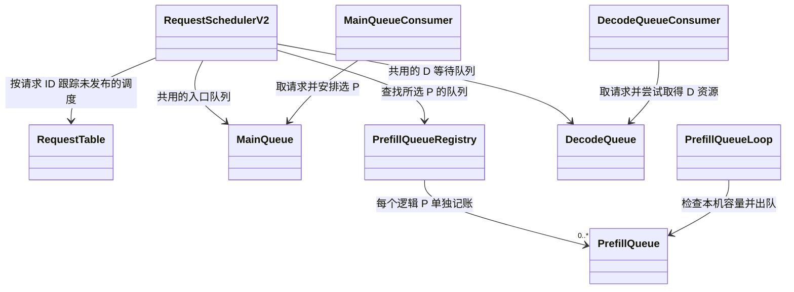
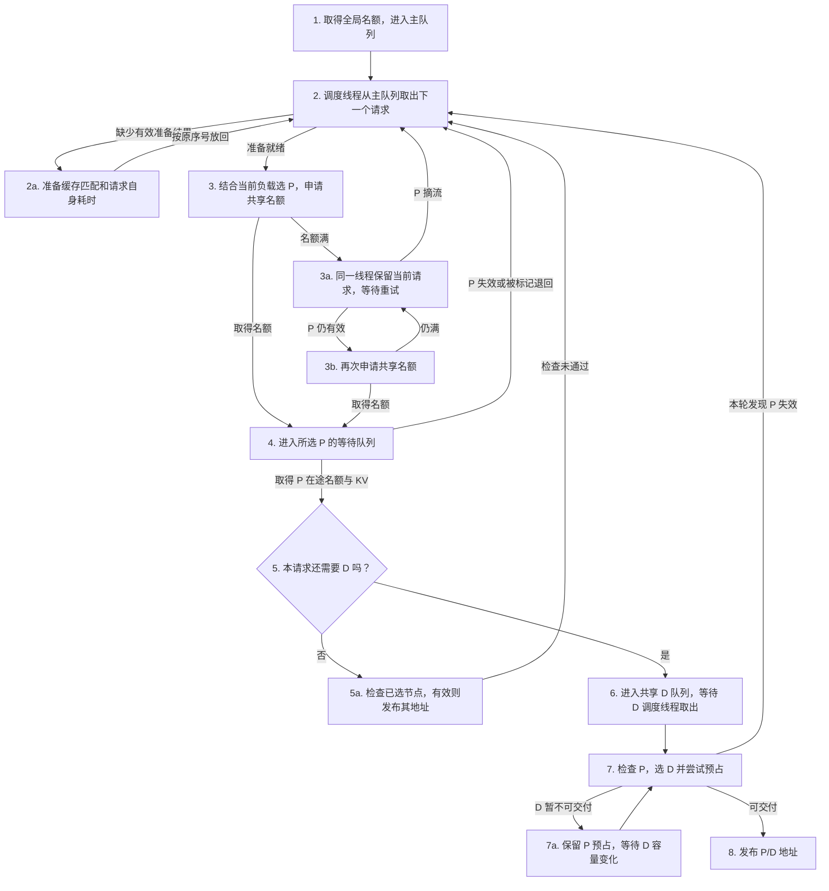
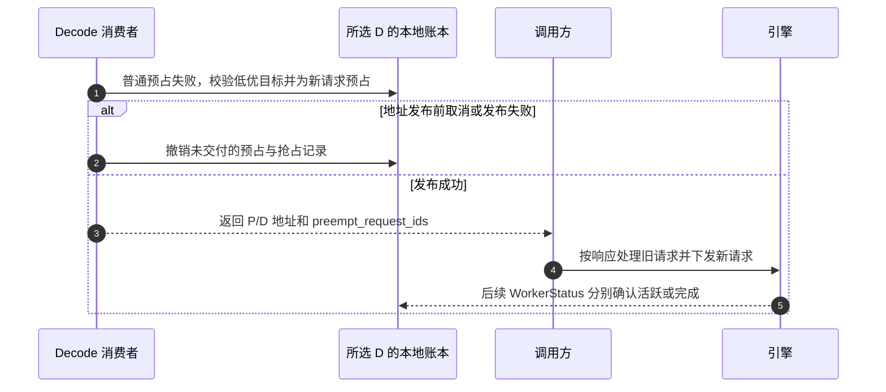

# AutoTPM：队列、优先级与抢占

一条 Generation 请求可能已经占用了 Prefill（P）的在途名额和 KV，却仍在等 Decode（D）。这时它也占着全局排队名额和共享子队列名额。即使有更高优先级的请求到达，调度器也不能把这条正在等 D 的请求退回主队列。只有仍在 P 队列里等待出队的请求，才可能因共享名额不足被退回。

## 一条请求经过哪些队列？

`NON_BATCH_V2` 的 Generation 请求都经过主队列和 P 队列，需要 D 时再进入 D 队列。`FIFO` 和 `PRIORITY` 使用相同的队列，但处理请求的顺序不同：

- **下一条处理哪个请求？** `FIFO`（先进先出）按首次进入主队列的顺序取出请求。`PRIORITY` 先取优先级高的请求，优先级相同才按入队顺序取。
- **没有空余名额时怎么办？** `FIFO` 不会为了新请求抢占已有请求。`PRIORITY` 在满足条件时允许抢占（preemption）：主队列可以让低优先级请求失败退出；P 队列可以把它退回主队列重新排队；D 节点则把待抢占请求的 ID 随调度响应返回，由调用方处理。

Encoder 使用[独立队列](../../architecture/routing/01-role-routing.md)。

### 三层队列在代码中的位置

箭头表示类之间的引用，不是执行顺序。P 队列按节点分开，因为进入这层时 P 已经选定；D 队列是共享的，因为等 D 的请求仍可在重试时选择不同的 D。调度器如何把这些对象连起来，见 [`RequestSchedulerV2` 构造函数](../../../flexlb-sync/src/main/java/org/flexlb/balance/schedulev2/RequestSchedulerV2.java)。

### 一次请求的入队、出队与重试

图中按 1–8 标出主流程。分离部署的常规请求在步骤 5 继续进入 D 队列，最后一起交付 P/D 地址。合一部署把 PDFusion 当作 P 来选，在步骤 5a 直接交付合一地址。显式指定角色的行为见 [Generation 选路决策](../routing/02-generation-routing-decisions.md)。

### 主队列：先取出的请求不一定先返回地址

入口把优先级归一为 1–100，数值越大越优先：有效请求字段优先于 gRPC 头 `x-dashscope-inner-qos-level`，再取配置默认值（内置 50）。请求的绝对截止时间在入口确定，准备、退回、重试都不续期。

请求首次入队时取得全局名额和顺序号。缓存匹配可以并行准备；准备线程池已满时，由取出该请求的调度线程完成准备。准备完成后，请求按原序号回到主队列，下一次被取出时再结合当前负载选 P。所有合法 P 都参与缓存匹配，此时不按容量过滤候选，评分见 [Generation 选路](../routing/02-generation-routing-decisions.md)。

调度线程选好 P 后才申请共享子队列名额。名额已满时，这个线程保留当前请求，稍后按最新配置重试，请求不重新排队。**正在准备或等待名额的请求，虽然不在主队列里，仍占全局排队名额。** 后来的高优先级请求可以排在其他等待请求之前，但不能中断线程已经开始的工作。

### Prefill：共享名额决定能否入队，本机容量决定能否出队

共享名额限制同一 P 角色已接入、尚待交付的总量；每个逻辑 P 则有自己的等待队列和串行出队线程。进入 P 队列时还未占本机在途名额。出队时，P 将引擎活跃请求与本地预占按 ID 去重，检查在途上限和可用 KV：

- **在途已满**：本轮停止。后面的小请求也需要一个在途名额，绕过队首没有用。
- **仅 KV 不足**：如果剩余 KV 放不下队首请求，线程可以先处理队列后面放得下的小请求。队首请求的等待时间达到 `dispatchStarvationThresholdMs` 后，线程就不再跳过它。阈值为 0 表示从一开始就等队首请求。
- **空 P**：在途数为零且在途上限允许时，可放行一个超过当前可用 KV 的请求。取得 P 预占后，即使仍在等 D，也不再按 P 等待项处理。

P 队列发现端点摘流或同地址已经换了一台 worker，会把等待项退回主队列。退回释放共享名额，保留全局名额、原顺序号与截止时间。

### Decode：等待 D 有空时，请求仍占用 P 的名额和 KV

单个部署只有一个流量 group。D 调度线程每次从共享 D 队列取出一个请求，先检查已选 P 是否仍然有效，再从 P 所属 group 中选 D。如果发现 P 已失效，就归还预占资源，让请求回到主队列重选。检查发生在每轮选 D 之前，返回地址时不会同时复查 P 和 D。

选到具体 D 时，线程先尝试在该节点预留资源，失败才可能在**同一 D** 上尝试抢占。如果选择器返回 `BLOCKED` 或 `REJECTED`，则可尝试把请求交给空闲 D：引擎上报的运行数和等待数都为零，本地也没有已预留或引擎已确认的请求。节点在同一次加锁操作内确认空闲并预留资源，避免两个线程同时把它当作空机。

如果仍未取得 D 资源，原线程保留当前请求和 P 预占，等容量变化后重选 D，请求不回到 D 队列。其他空闲线程可以继续处理队列里的请求。

## 三个位置的“抢占”分别改变什么？

下表中的低优先级均指**严格低于**新请求。同优先级不能互相抢占。

| 哪里没有空余资源 | 什么时候可以抢占哪些请求 | 原请求会怎样 | 新请求随后做什么 |
|---|---|---|---|
| 全局排队名额满 | PRIORITY 且达到 `highPriorityThreshold`；只选仍在主队列里的等待项，最低优先级中选最新的 | **失败退出**，释放全局名额。已被消费者取走的请求不在范围内 | 有剩余申请次数才重试。最后一次申请失败后仍可淘汰别人，但新请求自己也会被拒；释放的名额不专属它 |
| P 共享子队列名额满 | 同样需要达到高优阈值；只在**选中的 P** 的等待项中标记低优请求，不扫描其他 P 或 D 队列 | **退回主队列**，保留全局名额，不作为失败返回。由 P 线程执行退回，不受本机在途上限阻挡 | 原调度线程保留新请求，等名额释放后再次申请 |
| 所选 D 的常规预占失败 | 策略允许 `DECODE_ENGINE_OWNED`；只在该 D 上找优先级已知、已面向引擎且足以弥补容量缺口的低优请求。这里不检查主队列高优阈值 | **返回待抢占请求 ID**，由调用方处理；返回 ID 不是引擎已经停止这些请求的证明 | 在该 D 上校验目标并取得新请求预占；只有成功发布才向调用方交付 ID |

例如，新请求优先级为 80，已有请求优先级为 20，高优阈值为 50。如果全局排队名额已满，且已有请求仍在主队列，调度器可以让它失败退出。如果满的是 P 共享名额，且已有请求正在选中的 P 排队，调度器可以把它退回主队列。如果它已经占了 P 名额、正在等 D，就不属于前两种抢占的目标。

## Decode RETURN：谁负责停止旧请求？

如果取消先成功，FlexLB 撤销本次预占，不向调用方返回待抢占请求的 ID。如果调度结果先发布，调用方就会收到地址和 ID。FlexLB 不代替调用方向引擎发送 Cancel RPC，也不用等引擎确认后才返回 Schedule 响应。发布后释放哪些名额，见[容量与释放](02-capacity-and-release.md)。

**相关用例：** [MainQueueConsumerTest](../../../flexlb-sync/src/test/java/org/flexlb/balance/schedulev2/main/MainQueueConsumerTest.java) 验证共享名额已满时，只有选中 P 的等待请求会被退回；[PrefillQueueLoopTest](../../../flexlb-sync/src/test/java/org/flexlb/balance/schedulev2/prefill/PrefillQueueLoopTest.java) 验证何时可以跳过队首；[DecodeQueueConsumerTest](../../../flexlb-sync/src/test/java/org/flexlb/balance/schedulev2/decode/DecodeQueueConsumerTest.java) 覆盖等待 D、空机放行和撤销未发布的抢占。
