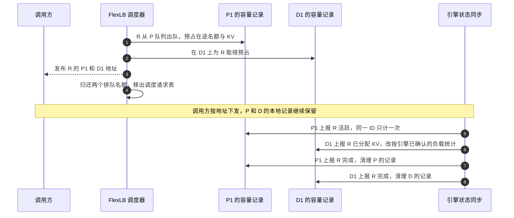

# 容量与释放

`Schedule` 返回地址后，请求释放排队名额，但仍占用所选节点的容量。主队列统计还在等地址的请求；Prefill 的在途计数还包括已预留资源或正在引擎上执行的请求。调用方拿到地址后才向引擎下发请求，此时若释放节点预占，同一份容量可能被分配两次。

下面跟踪一个 `NON_BATCH_V2` 的 Generation 请求 R。讨论的是 **FlexLB 用来判断能否再接请求的本地记录**；删除记录不是向引擎发送取消，也不是直接释放 GPU 显存。

## 各调度阶段的资源占用

| 请求位置 | 全局排队名额 | P 共享子队列名额 | P 本机在途与 KV | D 本地预占 |
|---|---|---|---|---|
| 主队列、准备中、已选 P 等共享名额 | 占 | 无 | 无 | 无 |
| 已进 P 队列、等出队 | 占 | 占 | 无 | 无 |
| 已从 P 出队、等 D | 占 | 占 | 占 | 成功预占前无 |
| 已取得 D 预占、未发布 | 占 | 占 | 占 | 占 |
| 已发布地址、引擎还没上报 R | 已归还 | 已归还 | 仍占 | 已取得的预占仍保留 |

**前两列是排队名额。** R 首次入主队列时占一个全局名额，选好 P 后再申请共享名额。这第二个名额是同角色的 P 队列共用的，不是某一台 P 的并发名额。上限为 `min(maxQueuedRequests, 逻辑端点数 × maxInflightPerPrefillWorker × prefillSubqueueLimitMultiplier)`，`PREFILL` 和 `PDFUSION` 分开计算。R 离开 P 队列去等 D 时，这两个名额都不归还。

**后两列是节点资源。** P 在出队前才预占一个在途名额，新占 KV 按 `max(0, 输入 token 数 − 该 P 的有效命中 token 数)` 估算。D 常规预占分别检查并发名额、输入所需 KV 和「输入 + 最大输出」的 KV 预算。它们是不同口径，不能把 P 的缓存抵扣直接套到 D 上。只需要 P 或 PDFusion 的请求不选 D，表中 D 一列始终为空。选点和空机放行条件见 [Generation 选路决策](../routing/02-generation-routing-decisions.md)。

例如，P1 的在途上限为 1。R 还在 P1 队列里时，不占这一个名额；一旦 R 从 P1 出队去等 D，即使调用方还没拿到地址，P1 的这个名额也已经用完。此时另一个请求仍可能**进入 P1 队列**（若排队名额充足），却不能**从 P1 出队**。

## 发布前：重试、重选与取消时的资源释放

| 发生了什么 | 谁处理，哪些资源发生变化 |
|---|---|
| D 暂时没有容量，R 继续等 | D 调度线程归还本次尝试中未能交付的 D 预占，保留 P 预占和两个排队名额。容量变化后重新选 D，不重新排主队列。 |
| 已选 P 失效，R 要回主队列重选 | 归还本轮已取得的 P/D 资源和共享名额，清除旧的 P 选择；保留全局名额、原顺序号和原截止时间。若 R 是仍在 P 队列里因高优先级请求而被退回，它尚未取得 P/D 预占，只需归还共享名额。 |
| 调用方取消、排队截止时间到达，或调度失败 | `RequestCleanup.releaseEnded` 移除 R 的等待项和 P 在途记录，归还已取得的排队名额并移出调度请求表；同时唤醒 D 调度线程，由它在实际选中的 D 上撤销自己的预占。 |

最后一种情况有一个容易遗漏的时刻：**D 刚预占成功，但地址还没发布，取消就到了。** 发布和取消竞争同一次请求阶段更新。取消先成功，D 线程就不能再发布地址，必须撤销刚取得的预占；如果本次还为 RETURN 抢占登记了待抢占请求，也一并撤销，不向调用方交付这些 ID。发布先成功则按下面的路径处理。抢占条件见 [AutoTPM](01-autotpm.md)。

## 发布后：引擎接收了 R，不等于 R 已经完成

下图举一个正常 P/D 分离请求。P 和 D 分别上报自己的状态；图中上报的先后只是示例，FlexLB 不等两端同时确认。

`RequestCleanup.releasePublished` 同时取消排队截止时间的定时任务。此时在 Generation 调度请求表里找不到 R 是正常的，不说明引擎已执行完毕，也不意味着可以复用 R 的 ID。

两端对「看到了 R」的处理并不相同：

| WorkerStatus 的证据 | P 如何计数 | D 如何计数（普通、未被抢占的 R） |
|---|---|---|
| 活跃列表包含 R | 引擎活跃 ID 和本地在途 ID 取并集。两边都有 R 仍只占一个名额；不再把 R 的预测 KV 从引擎可用 KV 中额外扣一次。 | 收到 `RECEIVED` 等早期阶段会刷新最近上报时间。到 `KV_ALLOCATED` 或 `RUNNING` 才把本地预占转为引擎已确认的负载；R 仍占容量。 |
| 上轮见过 R，本轮活跃列表不再包含它，未收到 Finished | P 可移除已被引擎观察过的 R 的本地记录，不必等迟到的 Finished 再释放一次。 | 对有真实本地预占、已确认的 R，单次缺失不足以释放容量；继续等待 Finished 或状态更新超时。 |
| 明确上报 R 的 Finished | 清理本端记录；即使之前没看到中间阶段也可以处理。 | 按对应请求和预占记录结束本端记账。P 的 Finished 不能代替 D 的 Finished。 |

### WorkerStatus 确认超时与本地预占回收

FlexLB 返回地址后由调用方下发。WorkerStatus 里没有请求 R 的 ID，既可能是引擎没有收到 R，也可能是引擎已经在执行 R，但 FlexLB 还没看到对应的上报。`statusUpdateTimeoutMs` 决定在缺少这份证据时，本地账本保留 R 的预占多久。

| 确认窗口 | 本地账本与引擎实际状态的偏差 | 对后续调度的影响 |
|---|---|---|
| **过长** | 引擎没有收到 R，本地账本却持续为它保留并发名额和 KV 预算，**高估节点占用**。 | 节点明明有余量，后续请求却可能继续排队。 |
| **过短** | 引擎正在执行 R，本地账本却在收到对应上报前清除了 R，**低估节点负载**。 | 在后续上报反映真实负载前，调度器可能继续向这台节点分配请求，加重实际排队和 KV 压力。 |

1. **何时开始计时：** 发布地址后，P、D 分别从发布时间计时。之后某一端上报 R 活跃，只刷新该端的时间；同一 worker 上报其他请求，不给 R 续期。发布前等地址用的是排队截止时间，不受这个窗口控制。
2. **何时判定超时：** 处理状态更新时，如果 R 尚有本地记录，且距发布或最近一次匹配到 R 的活跃上报（取较晚者）已达到当前 `requestLifecycle.request.statusUpdateTimeoutMs`（默认 1000 ms），该端按超时清理。不是到点触发的独立定时器：D 的同版本心跳只刷新本轮活跃请求，不扫描缺失请求，要等新版本状态对账才检查。整个节点停止上报时，另见[节点健康与退役](../../architecture/workers/01-discovery-and-registration.md)。
3. **清理什么：** P 移除 R 的本地在途记录和对应 KV 预占；D 清理 R 在该节点的本地预占及对应的容量计数。两端独立回收，各自上报 `auto_tpm.request.status_update_timeout.count`，用 `role`、`endpoint` 区分。全局和共享排队名额在发布时就已归还，不再扣减。

例如，D 发布后 1 秒内持续上报其他任务，却从未上报 R。若阈值是 1000 ms，D 在达到阈值后的新版本对账中释放 R 的本地预占，即使 P 仍在上报 R。**这个决定只表示 FlexLB 不再为 R 保留这份预占**：不发引擎 Cancel，不改写已返回的 Schedule 结果，也不能证明 R 已完成。

**vLLM 部署要求：** 在 **vLLM worker 进程**的环境中设置 `DS_LLM_VLLM_STEP_TIMEOUT_MS=10`（10 ms）。这是引擎侧的 step 超时配置；FlexLB 侧的 `statusUpdateTimeoutMs` 是等待请求状态确认的窗口，两者独立。10 ms 不是 WorkerStatus 的上报周期，也不要据此把 FlexLB 的确认窗口改为 10 ms。

## 容量问题的排查入口

- **主队列看着不长，却报全局已满：** 把异步准备、线程已取出但仍在等共享名额，以及等 P、等 D 的未发布请求都算进去。核对 [QueueCapacity](../../../flexlb-sync/src/main/java/org/flexlb/balance/scheduler/QueueCapacity.java) 的全局计数，而不是把几个队列长度当作总数。
- **地址已返回，P 在途数没降：** 先查 P 是否已上报该请求。等待首次上报、引擎仍在执行，都可能是正常占用；核对 [PrefillQueue](../../../flexlb-sync/src/main/java/org/flexlb/balance/schedulev2/prefill/PrefillQueue.java) 的活跃和完成记录。
- **P 已完成，D 仍满：** 查 D 自己上报的是 `RECEIVED`、`KV_ALLOCATED`、`RUNNING` 还是 Finished，以及是否只收到同版本心跳。D 的证据和释放条件见 [DecodeState](../../../flexlb-sync/src/main/java/org/flexlb/balance/endpoint/DecodeState.java)，监控口径见[可观测性](../../architecture/reference/03-observability.md)。
