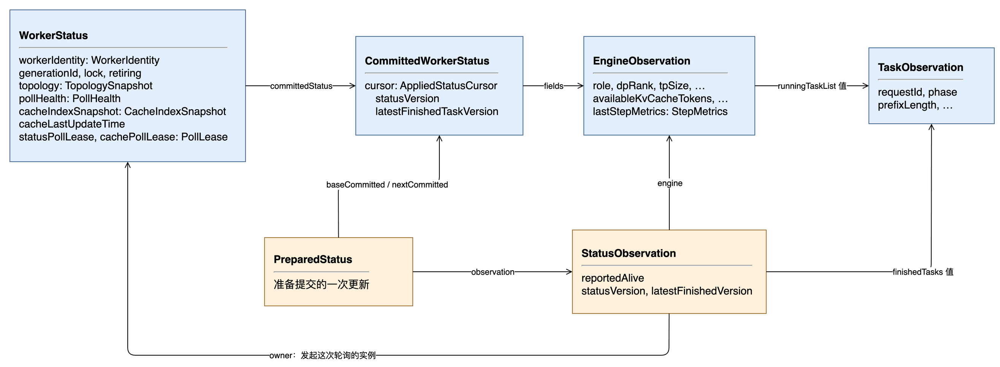
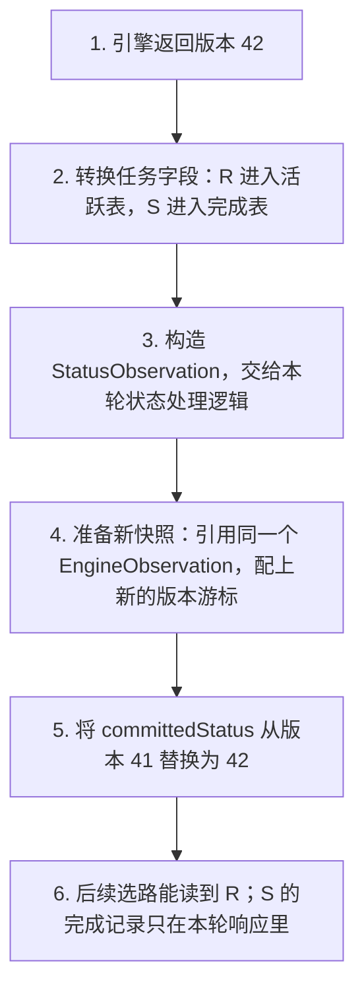

# WorkerStatus 的对象结构与数据流

[`WorkerStatus`](../../../flexlb-common/src/main/java/org/flexlb/dao/master/WorkerStatus.java) 代表**一个逻辑 worker 的一次注册**。服务发现创建它，状态轮询和缓存轮询都持有它，endpoint 从它读取引擎状态。外层对象一直不换，里面的数据按各自的节奏替换。即使两次注册的 `ip:port@index` 完全相同，也会有两个不同的 `WorkerStatus`：旧 RPC 回来时，看它属于哪个对象，就知道它能不能更新现在的节点。

## 一个 WorkerStatus 实例的布局



[可编辑的类图（draw.io）](worker-status.drawio)。箭头表示引用，省略了 `AtomicReference` 和 `Map`。橙色对象只在处理一次 RPC 时使用。沿 `engine` 和 `fields` 两条箭头看：本轮响应与提交后的快照引用同一个 `EngineObservation`，不复制活跃任务表；完成表只挂在响应上。

下面只列 `WorkerStatus` 实例实际持有的字段。缩进表示下一层引用。

```text
WorkerStatus
├─ workerIdentity, generationId          固定地址标识、本次注册编号
├─ lock, retiring                        本次注册的锁、是否已开始退役
├─ topology: AtomicReference<TopologySnapshot>
│  └─ ip, port, grpcPort, engineIndex, multiEngineNum, group, site, deploymentName
├─ committedStatus: AtomicReference<CommittedWorkerStatus>
│  ├─ fields: EngineObservation
│  │  ├─ role, KV 容量, DP/TP 信息, 队列长度等
│  │  ├─ runningTaskList: Map<请求 ID, TaskObservation>
│  │  └─ lastStepMetrics: StepMetrics
│  └─ cursor: AppliedStatusCursor
│     └─ statusVersion, latestFinishedTaskVersion
├─ pollHealth: AtomicReference<PollHealth>
├─ cacheIndexSnapshot: AtomicReference<CacheIndexSnapshot>
│  └─ cacheStatus, indexInitialized, indexedVersion
├─ cacheLastUpdateTime: AtomicLong
└─ statusPollLease, cachePollLease: 两个独立的 AtomicReference<PollLease>
```

源码末尾的大部分 getter 都是这棵树的快捷入口，没有同名字段的第二份存储。比如 `getAvailableKvCacheTokens()` 读 `committedStatus → fields → availableKvCacheTokens`，`getGroup()` 读 `topology → group`，`isAlive()` 读 `pollHealth → reportedAlive`。

**一起读的数据，一起替换。** 任务表和版本号必须来自同一次上报，所以 `committedStatus` 一次发布 `fields` 和 `cursor`。服务发现改 `site` 只换 `topology`，不会改变任务表的版本。整棵树不是一份快照。

`StatusObservation.owner` 指向发起轮询的 `WorkerStatus`，不是反过来。`StatusObservation` 和准备提交用的 `PreparedStatus` 都是临时对象，所以不在成员树里。

**锁和原子引用管的是两件事。** 更新线程持有本实例的 `lock`，检查节点还没退役，再准备和发布状态。退役也用同一把锁，避免检查完节点还有效、写入时却已经换代。读线程取已发布的快照不需要这把锁；已经取到旧快照的线程可以继续读旧数据。锁保护的是一次注册，不会让所有 worker 的轮询排成一队。

## 一次状态更新：版本 41 到 42

假设 FlexLB 已经收到了版本 41。引擎这次返回版本 42：请求 R 还在运行，请求 S 刚刚结束。

[EngineStatusConverter](../../../flexlb-sync/src/main/java/org/flexlb/service/grpc/EngineStatusConverter.java) 先把 protobuf 里的任务转成 Java 对象。R 和 S 各生成一条 `TaskObservation`，按请求 ID 分别放进活跃表和完成表。**逐字段复制发生在这一步。** 两张表从这里开始按引用传递；代码没有把 Map 包装成不可修改的集合，所以转换结束后不能再改它。

`EngineObservation` 保存本轮的 KV 容量、队列长度、DP 信息和活跃表。如果引擎上报了最近完成的调度步，它还带一份 `StepMetrics`。`StatusObservation` 在外面多包了一层，把这些引擎数据和**本次 RPC** 的信息放到一起：哪个 `WorkerStatus` 发起了轮询（`owner`）、引擎是否存活、版本号，以及这次收到的完成表。`activeTasks()` 只是 `engine().runningTaskList()` 的简写，两者指向同一张表。



第 4 步对应 `prepareNewStatus()`。它创建一个 `AppliedStatusCursor`，记下状态版本 42 和已经读到的完成记录版本。后一个值只向前推进，下一次 RPC 靠它增量拉取 Finished。`CommittedWorkerStatus` 只有两个成员：`fields` 指向刚才的 `EngineObservation`，`cursor` 指向新游标。这里没有再复制 R，也没有把 S 的完成记录加进长期保存的快照。

`PreparedStatus` 是第 4、5 步之间的临时对象，只存三个引用：准备时读到的旧快照 `baseCommitted`、本次响应 `observation`、准备发布的新快照 `nextCommitted`。准备和发布都在该 worker 的锁内进行。发布时，`publishPreparedStatus()` 检查响应确实属于这个实例，而且 `committedStatus` 仍指向准备时读到的旧快照，才用 `compareAndSet` 换上新快照。这样，同一份更新不能发布两次；读者看到的也是版本 41 的字段和游标，或版本 42 的字段和游标，不会各取一半。同版本心跳不走这次替换，具体分支见 [handleStatusResponse](../../../flexlb-sync/src/main/java/org/flexlb/sync/runner/GrpcWorkerStatusRunner.java)。

需要同时读取版本和任务时，先取一次快照：

```java
var snapshot = workerStatus.committedWorkerStatus();
var version = snapshot.cursor().statusVersion();
var running = snapshot.fields().runningTaskList().get("R");
```

即使下一行执行前版本 43 已经发布，`version` 和 `running` 仍来自同一轮。分别调用 `appliedStatusCursor()` 和 `committedEngineObservation()` 则会读两次 `committedStatus`，中间可能恰好换了版本。要处理 S 的完成通知，应在本轮回调里读 `observation.finishedTasks()`。

## 不随引擎快照更新的成员

**地址和注册信息。** `WorkerIdentity` 在创建时固定下来，用来生成物理地址、逻辑地址和监控标识。`TopologySnapshot` 也包含地址，但还记录服务发现提供的 `site`、流量 `group` 和 `deploymentName`。标签变化时，`updateDiscoveryLabels()` 沿用原地址，替换这份记录。worker 开始退役时设置 `retiring`，旧轮询即使稍后返回，也不能给同地址的新实例发布状态。见[发现与注册](../../architecture/workers/01-discovery-and-registration.md)。

**轮询结果。** `PollHealth` 记录上一次成功时间、两次成功之间的间隔、连续失败次数，以及引擎上次报告的 `alive`。一次 RPC 失败会增加失败计数，不会清空上一轮已提交的任务表。`isAlive()` 读的是这个上报值；判断节点能否参加选路，还要看 endpoint 和 DP 组。

**缓存索引。** `getAvailableKvCacheTokens()` 读的是状态 RPC 上报的剩余 KV；`getCacheStatus()` 读的是另一条缓存轮询链路。缓存响应到达后，`publishCacheStatus()` 把它放进 `CacheIndexSnapshot`，保留原来的索引版本。等本地索引更新完成，`publishCacheIndexedVersion()` 才登记对应的版本。区分这两步，是因为收到缓存数据并不表示已经能用它查询。`cacheLastUpdateTime` 单独记录缓存轮询成功的时间。

**在途 RPC。** 状态轮询和缓存轮询各有一个位置：`statusPollLease` 和 `cachePollLease`。`PollKind` 区分两类调用；每次成功占用位置都会得到一个新的 `PollLease`。结束时 `close()` 只清除指向自己的引用。即使旧回调重复执行 `close()`，也不会把下一次 RPC 的位置清掉。

P/D 为刚调度的请求预留了多少资源，也不在 `WorkerStatus` 里。那是 FlexLB 自己的记录，分别见[容量与释放](../../design/scheduling/02-capacity-and-release.md)中的 `PrefillQueue` 和 `DecodeState`。一份上报如何改变这些记录，见[状态与反馈](../../architecture/workers/02-status-and-feedback.md)。

## 附录：WorkerStatus 协议字段

字段名与 [gRPC 协议](../../../../cpp/model_rpc/proto/model_rpc_service.proto)一致。节点状态见 `WorkerStatusPB`；活跃列表和完成列表里的每条请求都是 `TaskInfoPB`；节点最近一次调度步的采样是 `WorkerStepMetricsPB`。表中“仅保留”表示转换器读入了这个值，但当前 V2 不用它选节点；“未读入”表示协议有这个字段，Java 快照没有。

### 节点：`WorkerStatusPB`

| 字段 | 含义 | FlexLB 中的用途 |
|---|---|---|
| `role` | 字符串角色名，如 `PREFILL`。 | 兼容用字符串报告角色的引擎，解析结果须与服务发现的角色一致。 |
| `role_type` | 同一角色的枚举表示。 | 与角色名一起解析、校验，确定按 P、D 或其他角色处理本轮状态。 |
| `alive` | 引擎报告自己是否存活。 | `false` 会触发当前实例退役；`true` 不等于有容量，也不代表同组 DP rank 已齐全。 |
| `status_version` | 节点状态的版本号。 | 比已提交版本高才替换快照；同版本按心跳处理，版本倒退触发退役。 |
| `latest_finished_version` | 本轮返回的完成记录游标。 | 提交时保留不倒退的游标，下次轮询据此增量拉取 Finished。它不是完成请求数。 |
| `dp_master_address` | 引擎所在 DP 组的 master 地址。 | 按相同地址识别同角色的 DP 成员；未上报时不做这项分组。它不是流量 group。 |
| `dp_size` | DP 组应有的 rank 数。 | 检查组内成员报告的规模是否一致，以及 rank 是否齐全。 |
| `dp_rank` | 该 worker 在 DP 组内的序号，从 0 开始。 | 检查重复、越界和缺失 rank；选中节点后随结果返回。 |
| `tp_size` | 一个 TP 实例协作计算的 rank 数。 | 用于描述拓扑、记录状态，不按此值扩展候选地址。跨机 TP 的业务入口来自服务发现。 |
| `waiting_query_len` | 正在引擎队列中等待的请求数，不含 FlexLB 队列。 | 计入 Encoder 并发比较；D 只有在这个数和运行数都为零时才可能走空机分支。 |
| `running_query_len` | 引擎报告的运行请求数。 | 与等待数、本地尚未观察到的请求一起用于 Encoder 选点；D 也用它检查空机。不能用活跃表长度替代。 |
| `running_task_info` | 当前活跃任务列表，包含已经收到但尚未运行的请求。 | 转成按请求 ID 索引的活跃表，与本地预占去重、更新 P 剩余工作和 D 已确认负载。 |
| `finished_task_list` | 增量完成记录，可包含成功或失败的任务。 | 通知对应角色清理记录，也可触发缓存预测对照。该列表只属于本轮响应。 |
| `available_kv_cache` | 引擎报告的可用 KV 容量，FlexLB 按 token 计。 | P/D 检查还有多少 KV 能给新请求；还要扣除引擎未计入的本地预占。 |
| `total_kv_cache` | 节点 KV 总容量，单位为 token。 | D 用它计算百分比预算；总量减去可用量是已用 KV，可参与 D 的成本评分。 |
| `available_concurrency` | 协议保留的可用并发数。有的引擎不填，读到 0。 | 兼容读取并写状态日志。V2 不用它筛选候选、判断容量或抢占。 |
| `block_size` | 每个 KV 块包含的 token 数。 | 解释引擎的块大小并上报指标。它不能替代非空客户端 `block_cache_keys` 所需的 `cache_key_block_size`。 |
| `block_hash_lookahead_tokens` | 引擎计算一个完整块的哈希时，还会包含块后多少个 token。 | 保留这项哈希规则；FlexLB 使用客户端提供的 keys，不在选路时用它重算。 |
| `kv_cache_group_mode` | 实例的缓存布局，如全注意力、含 Mamba 或含滑窗注意力。 | 未显式配置 KVCM 查询类型时，用它选择相应的匹配方式。 |
| `cache_match_rollback_blocks` | 引擎即使命中也需要重新计算的块数。 | Local Standby 从匹配块数里减去它，结果不低于零。 |
| `max_seq_len` | 引擎支持的最大序列长度，单位为 token。 | 仅保留；不是 V2 对当前请求计算出的 D 节点 KV 预算。 |
| `max_batch_tokens_size` | 引擎一个批次允许的 token 上限。 | 仅保留；V2 不据此为返回地址的请求组批或给 P/D 排名。 |
| `step_latency_ms` | 引擎上报的调度步耗时，单位 ms。 | 用于状态日志和负载统计，不是 P 选路使用的预计首 token 时间。 |
| `iterate_count` | 节点上报的迭代计数。 | 记录节点运行状态，不按迭代数给节点排序。 |
| `last_step_metrics` | 最近完成的非空调度步的统计，未上报时 Java 中为 `null`。 | 用于按步采样的监控，不是实时容量。子字段逐项列在下表。 |
| `precision` | 引擎报告的计算精度字符串。 | 当前转换器未读入，FlexLB 不用它匹配请求与节点。 |

### 调度步：`WorkerStepMetricsPB`

这些值用于观测引擎已经完成的工作，不决定 FlexLB 的下一次选路。两次轮询之间可能经过多步，因此采样结果不是所有 step 的流水记录。

| 字段 | 含义 | 读数方式 |
|---|---|---|
| `step_id` | 本次采到的已完成调度步的编号。 | 同一逻辑 worker 按步号去重，重复轮询不应重复计入该步。 |
| `completed_time_ms` | 引擎完成该步的时间戳，单位 ms。 | 标记样本发生的时间，不是 FlexLB 收到 RPC 的时间。 |
| `total_scheduled_tokens` | 该步实际调度的 token 总数。 | 包含 Prefill 和 Decode，不能全部算作 Prefill 工作量。 |
| `prefill_request_count` | 该步中参与 Prefill 的请求数。 | 大于零说明该步含 Prefill；纯 Decode 步为零。 |
| `prefill_tokens` | 该步实际调度的 Prefill token 数。 | 用来观察每步处理的输入量，不是节点剩余 KV。 |
| `token_budget` | 引擎为该步设置的 token 预算。 | 与实际调度量对照，区分预算小和预算未用满。 |
| `budget_fill_ratio` | 使用的 token 数占该步预算的比例。 | 分子是全部已调度 token，不能把它当作 Prefill 命中率。 |

### 请求：`TaskInfoPB`

时间戳表示引擎上的时刻，耗时表示两个时刻之间的间隔，表中均以 ms 计。阶段时间戳为 0 通常表示未记录；有效时间戳算出的耗时可以为 0。FlexLB 判断请求确认是否超时用本机看到上报的时间，不用这些引擎时间戳。

| 字段 | 含义 | FlexLB 中的用途 |
|---|---|---|
| `request_id_str` | vLLM 和 SGLang 用此字段上报字符串请求 ID。 | 非空白时原样使用，例如 `"007"` 保留前导零；不转为数值。 |
| `request_id` | RTP-LLM 用此字段上报 `int64` 请求 ID。 | `request_id_str` 为空白时，将此数值转为字符串作为内部键，例如 `7` 变为 `"7"`。两个字段都未填写时得到 `"0"`。 |
| `phase` | 当前任务阶段：`PENDING`、`RECEIVED`、`KV_ALLOCATED` 或 `RUNNING`。 | 非默认值优先。D 区分“收到请求”和“已分配 KV 或运行”，只有后者才转为引擎已确认负载。 |
| `is_waiting` | 旧协议用于区分等待与运行的标志。 | `phase` 是默认值时，`true` 解释为等待，`false` 按旧协议解释为运行。 |
| `input_length` | 引擎记录的本阶段输入 token 数。 | Encoder 用活跃任务的编码输入量估算负载，D 用它更新已确认请求的记录；不保证等于客户端原始 prompt 长度。 |
| `prefix_length` | 已匹配的前缀 token 数。 | P 修正剩余计算时间，并与选路时的预测对照；只有有效的 0 才表示零命中。 |
| `prefix_length_valid` | 引擎是否已确认并准备好本次缓存命中。 | 为假时不能用 `prefix_length` 修正工作量，也不能把它当实际命中做对照。 |
| `remaining_prefill_tokens` | 引擎上报的剩余 Prefill 计算量，可缺省。 | 用于修正 P 已有工作量，进而影响后续请求的 TTFT 估计。缺失时不扣除已完成工作；首次看到 0 也不直接判定算完。 |
| `completed_prefill_tokens` | 已完成 GPU 前向计算的 Prefill token 数，可缺省。 | 保留“未上报”和“明确为零”的区别；当前 P 工作量修正不直接读取此值。 |
| `last_completed_prefill_step_id` | 最近完成 Prefill 计算的步号，可缺省。 | 保留进度记录，不用步号代替剩余计算量或 Finished 通知。 |
| `error_info` | 本次任务的错误详情，包含错误码和错误消息。 | 完成记录据此区分成功和失败；转换器在没有错误详情时使用错误码 0。 |
| `priority_preemption_progress` | 引擎报告的抢占取消进度：无、取消中或已取消。 | 保留取消进度；活跃列表中的取消标志不是独立的 Finished 记录。 |
| `priority` | 协议中的任务优先级。 | 当前转换器未读入。AutoTPM 使用 [Schedule 入口确定的优先级](../../design/scheduling/01-autotpm.md)。 |
| `dp_rank` | 报告该任务的 DP rank。 | 记录执行位置；检查 DP 组是否齐全用的是节点级 `WorkerStatusPB.dp_rank`。 |
| `batch_id` | 引擎侧的执行批次 ID。 | 随任务反馈记录在 PV 中，不是 FlexLB 主队列的入队序号。 |
| `request_received_time_ms` | 引擎收到请求的时间戳。 | 用作引擎侧请求耗时的起点，和进入 waiting 的时刻比较。 |
| `input_queue_enqueue_time_ms` | 请求进入引擎输入队列的时间戳。 | 用作输入队列等待耗时的起点，不是进入 FlexLB 主队列的时间。 |
| `input_queue_drain_time_ms` | 请求被取出引擎输入队列的时间戳。 | 减去输入队列入队时间，得到 `inputQueueWaitMs`。 |
| `waiting_entered_time_ms` | 最近一次进入引擎等待状态的时间戳；被抢占后可能重新进入等待。 | 与进入运行的时刻计算这一次等待的耗时，不一定是请求首次到达时间。 |
| `running_entered_time_ms` | 最近一次进入引擎运行状态的时间戳。 | 是 waiting→running 的终点，也是 running→首 token 的起点。 |
| `first_token_time_ms` | 引擎产生首个 token 的时间戳。 | 用于计算实际的首 token 阶段耗时，与选路前的 TTFT 估计区分。 |
| `end_time_ms` | 引擎记录的任务结束时间戳。 | 保留结束时刻；回收看任务是否出现在完成列表，不单凭时间戳判定。 |
| `waiting_time_ms` | 引擎记录的任务等待时长。 | 保留用于诊断；不是 FlexLB 为候选节点预测的排队时间。 |
| `execution_time_ms` | 引擎记录的任务执行时长。 | 描述本次任务已发生的执行，不直接用作新请求的预计计算时间。 |
| `remote_kv_wait_ms` | 请求等待远端 KV 的时长。 | PV 用它分解 waiting→running 耗时，区分等远端 KV 和其余调度等待。 |
| `iterate_count` | 单个任务的迭代计数。 | 保留任务进度信息，不与节点级迭代计数混用，也不据此给 D 排名。 |
| `hbm_local_match_tokens` | 在本机显存中匹配到的 token 数。 | 当本地值加远端增量等于有效前缀长度时，作为实际命中的本地部分写 PV。 |
| `remote_kv_added_match_tokens` | 在本地命中之外，远端 KV 额外贡献的 token 数。 | 与本地值核对后作为远端部分写 PV；不是选路时折算的远端命中预测。 |
| `first_prefill_step_id` | 此请求参与的第一个 Prefill step 编号。 | 状态 PV 用它定位 Prefill 开始的那一步。 |
| `last_prefill_step_id` | 此请求参与的最后一个已记录的 Prefill step 编号。 | 状态 PV 用它定位末步；它是编号，不是步数。 |
| `prefill_step_count` | 此请求经历的 Prefill 步数。 | 统计一次请求分多少步处理，不用首末步号之差代替。 |
| `prefill_nonfinal_chunk_tokens_min` | 除最后一个分块外，最小分块的 token 数。 | 观察真实分块下限；没有非末块时不产生该指标的样本。 |
| `prefill_nonfinal_chunk_tokens_max` | 除最后一个分块外，最大分块的 token 数。 | 观察真实分块上限，避免把可能明显较短的末块混入分块比较。 |
